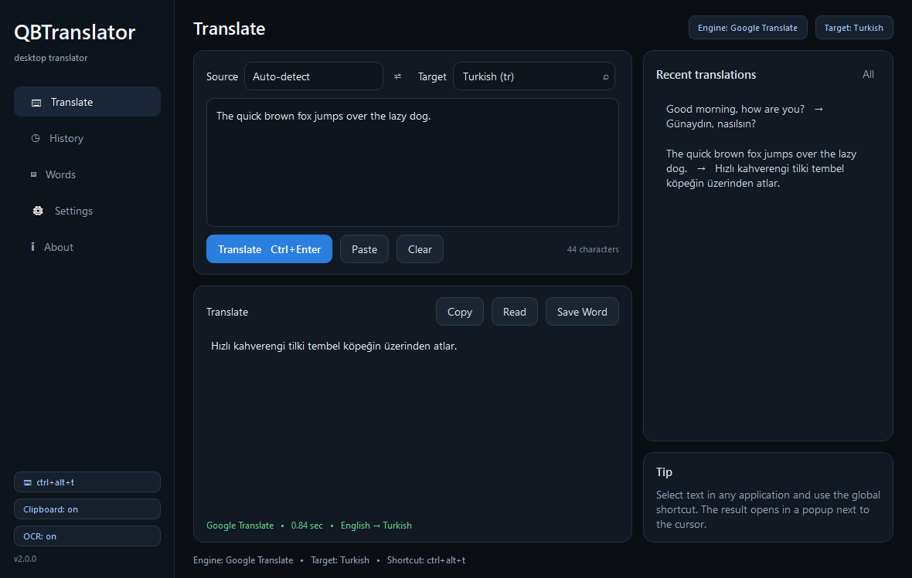

# QBTranslator

**Version 2.0.0. A fast, local-first Windows desktop translator built with PySide6.**

QBTranslator translates text selected in any application with a global shortcut and
shows the result beside the cursor. It can also read a screen region with OCR and
translate the recognized text. History and saved words stay on the local computer.

[Features](#features) | [Installation](#installation) | [Source setup](#running-from-source) | [Building](#building) | [Privacy](#privacy-and-security) | [License](#license)



## Highlights

- Native Qt interface with a compact dark theme and medium-weight typography
- Global selection translation with a frameless popup beside the cursor
- OCR screen-region translation with a full-screen selection overlay
- Searchable, accent-insensitive target language picker
- Google Translate, MyMemory, LibreTranslate, Lingva and OpenAI-compatible LLM engines
- Local history with search, detail view, copy, save and delete tools
- Saved words with search, CSV export and card study mode
- Clipboard monitoring, system tray, autostart, single instance and background mode
- Turkish and English interface with an optimized, dependency-free locale catalog
- Local JSON storage with atomic writes, validation and backup recovery

## Features

### Translation

- Translate selected text from any application with a global shortcut.
- Show the result in a frameless, draggable popup next to the cursor.
- Copy, read aloud or save the translation directly from the popup.
- Swap the translated text and translate back for a quick round-trip check.
- Change the target language from the popup with a dedicated searchable picker.
- Translate manually from the main window with `Ctrl+Enter`.

### OCR

- Select a screen region with a full-screen Qt overlay.
- The area outside the selection is dimmed for precise selection.
- Recognize text with the built-in Windows OCR engine.
- Fall back to Tesseract when Windows OCR is unavailable.
- Improve small or dark captures with automatic upscaling and inversion.
- Translate the recognized text in the same popup workflow.

### Engines and languages

- Google Translate as the default engine.
- MyMemory, LibreTranslate, Lingva and OpenAI-compatible LLMs.
- Configurable endpoints, models and optional API keys.
- Optional fallback chain across backup engines.
- Response validation, friendly errors and a bounded translation cache.
- Turkish and English interface, with English language aliases in search.

### History and words

- Searchable local translation history.
- Detail dialog with copy and text-to-speech actions.
- Save a history record as a word, copy it or delete it.
- Saved-word search, deletion and UTF-8 BOM CSV export.
- Card study mode with reveal, next, previous and speak actions.
- Configurable history limit and empty or no-match states.

### Windows integration

- Global hotkeys with validation and rollback on conflicts.
- Hotkey capture dialog for the translation and OCR shortcuts.
- Optional start with Windows.
- System tray icon with open and quit actions.
- Closing the window minimizes to the tray; explicit quit is available in Settings.
- Single-instance guard brings the existing window forward.
- `--background`, `--minimized`, `--quit` and `--selftest` command line flags.
- Clipboard monitoring with URL and length filtering.
- Window geometry, source language and all settings persist between runs.
- Per-section settings save buttons become available only after a change.

## Requirements

- Windows 10 or Windows 11, 64-bit
- Python 3.11 or newer when running from source
- PySide6 6.10 or newer
- Internet access for online translation engines
- A Windows OCR language pack for OCR. Tesseract is an optional fallback.

The release builds do not require Python or PySide6 to be installed.

## Installation

Download the latest release from the
[Releases](../../releases) page.

| Package | Recommended use |
|---|---|
| `QBTranslator-Setup-<version>.exe` | Per-user installer, no administrator rights required |
| `QBTranslator-<version>-windows-x64.zip` | Onedir package, fastest startup and lowest runtime memory |
| `QBTranslator-Portable-<version>.exe` | Single-file portable build, slightly slower first start |

The installer places the application under `%LOCALAPPDATA%\Programs\QBTranslator`.
The onedir package can be extracted anywhere. The portable executable runs directly.

OCR needs the relevant Windows OCR language pack. Install Tesseract separately only if
the Windows OCR engine is unavailable.

## Running from source

```powershell
cd C:\path\to\QBTranslator
python -m pip install -e ".[dev]"
python -m qbtranslator
```

From a source checkout without installing the package:

```powershell
python run.py
```

For a temporary data directory during development:

```powershell
$env:QB_DATA_DIR = "$env:TEMP\qbtranslator-dev"
python run.py
```

## Command line

```text
--background, --minimized   Start hidden in the system tray
--quit                      Quit a running background instance
--selftest                  Run Qt, asset, import and mocked translation checks
```

## Building

The packaging configuration is intentionally minimal. Only QtCore, QtGui, QtWidgets
and the required platform and image plugins are included. QML, Quick, WebEngine,
Multimedia, Network, SQL, PrintSupport, OpenGL helpers and development tooling are
excluded. UPX is disabled to preserve startup speed and avoid antivirus false positives.

```powershell
python -m pip install pyinstaller==6.20.0
powershell -ExecutionPolicy Bypass -File build_tools\build.ps1
```

Artifacts are written to `release/`:

- `QBTranslator-<version>-windows-x64.zip` (onedir, recommended)
- `QBTranslator-Portable-<version>.exe` (single file)
- `QBTranslator-Setup-<version>.exe` when Inno Setup 6 is installed
- `SHA256SUMS.txt`

The build script runs `--selftest` against both packaged variants.

## Development

```powershell
python -m pytest
python -m ruff check src tests
python -m compileall -q src tests
```

The test suite covers translation engines, storage recovery, language search,
hotkeys, dialogs, settings, history, words, clipboard, OCR, autostart, single
instance and localized UI state.

## Project structure

```text
src/qbtranslator/
  application.py       Application lifecycle, CLI and single instance
  i18n.py              Locale catalog loader
  core/                Translation, storage, OCR, Windows APIs and tray
  ui/                  Qt main window, popup, dialogs and theme
  locales/             Turkish and English catalogs
  assets/              Application icon and checkbox asset

build_tools/           PyInstaller specs, version metadata and build script
docs/                  Architecture, feature parity and roadmap
tests/                 Automated tests
```

## Performance and footprint

The release build is deliberately restricted to the Qt modules used by the
application. Typical measurements for version 2.0.0:

| Artifact | Size |
|---|---:|
| Onedir directory | about 59.6 MB |
| Onedir ZIP | about 24.3 MB |
| Portable single file | about 24.3 MB |

The onedir package is recommended: it starts faster and uses less temporary disk
I/O than the single-file build. The single-file build extracts its runtime to a
temporary directory on launch, so its first start is slightly slower.

## Privacy and security

- No telemetry, analytics or background uploads are included.
- Translated text is sent only to the engine selected in Settings.
- History, saved words, window state and settings remain under
  `%LOCALAPPDATA%\QBTranslator\data`, unless `QB_DATA_DIR` overrides the location.
- API keys are stored in the local `config.json` only. Protect your Windows account
  and data directory if you use private endpoints.
- The application does not bundle Google, MyMemory, LibreTranslate, Lingva or LLM
  services. Their terms and privacy policies apply when you use them.
- Release binaries are unsigned. Verify the SHA-256 hashes published with each
  release if you need integrity confirmation.

Please report security issues privately as described in [SECURITY.md](SECURITY.md).

## Documentation

- [Architecture](docs/architecture.md)
- [Feature parity](docs/feature-parity.md)
- [Roadmap](docs/roadmap.md)
- [Release guide](RELEASING.md)
- [Third-party notices](THIRD_PARTY_NOTICES.md)

## License

MIT. See [LICENSE](LICENSE).

PySide6 and Qt are distributed under their respective licenses. See
[THIRD_PARTY_NOTICES.md](THIRD_PARTY_NOTICES.md) and the files under `LICENSES/`.
