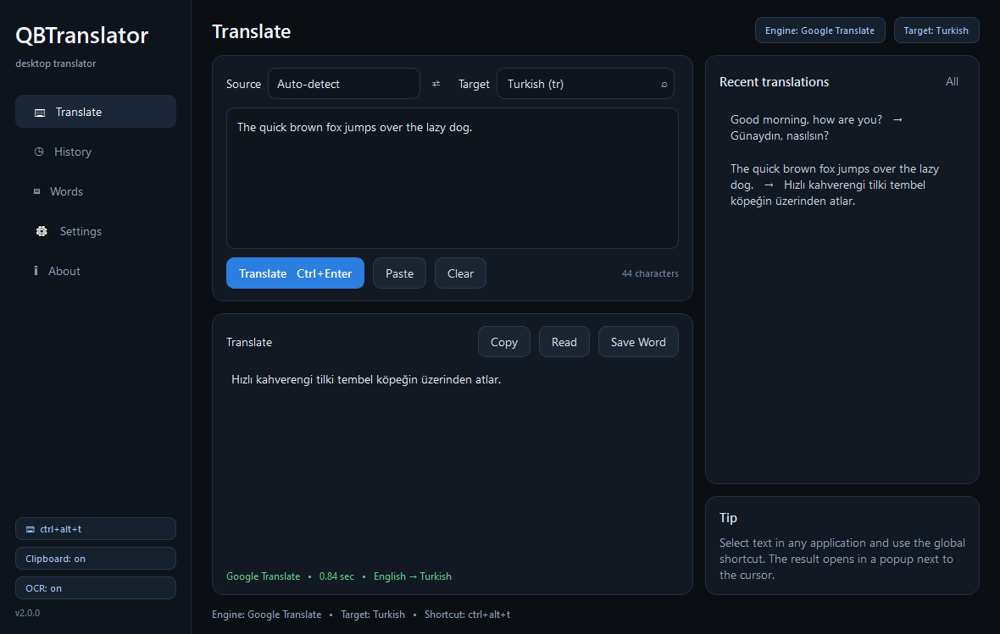

# QBTranslator

**Sürüm 2.0.0. PySide6 ile yazılmış hızlı ve yerel öncelikli Windows çeviri uygulaması.**

[English README](README.md)

QBTranslator, herhangi bir uygulamada seçtiğiniz metni global kısayolla çevirir ve
sonucu imlecin yanında gösterir. Ekran bölgesi seçerek OCR ile metin okuyabilir ve
aynı balonda çevirebilir. Geçmiş ve kayıtlı kelimeler bilgisayarınızda kalır.



## Öne çıkanlar

- Qt tabanlı koyu arayüz ve okunaklı tipografi
- Global kısayolla seçili metni çevirme
- Tam ekran seçim katmanıyla OCR çevirisi
- Aranabilir, aksan duyarsız hedef dil seçici
- Google Translate, MyMemory, LibreTranslate, Lingva ve LLM motorları
- Geçmiş arama, detay, kopyalama, kelime kaydetme ve silme
- Kelime arama, CSV dışa aktarma ve kart çalışma modu
- Pano izleme, sistem tepsisi, otomatik başlatma ve tek örnek
- Türkçe ve İngilizce arayüz
- Yerel JSON depolama, yedekleme ve bozuk veri kurtarma

## İndirme

En son sürümü
[Releases](../../releases) sayfasından indirin.

| Paket | Öneri |
|---|---|
| `QBTranslator-Setup-<sürüm>.exe` | Yönetici hakkı gerektirmeyen kullanıcı kurulumu |
| `QBTranslator-<sürüm>-windows-x64.zip` | En hızlı açılış ve en düşük bellek kullanımı |
| `QBTranslator-Portable-<sürüm>.exe` | Tek dosya taşınabilir sürüm |

Kurulum sürümünde Python gerekmez. OCR için ilgili Windows OCR dil paketi
kurulmalıdır. Windows OCR kullanılamıyorsa Tesseract isteğe bağlı yedek olarak
kullanılabilir.

## Kaynaktan çalıştırma

```powershell
cd C:\path\to\QBTranslator
python -m pip install -e ".[dev]"
python -m qbtranslator
```

Paket kurmadan:

```powershell
python run.py
```

## Komut satırı

```text
--background, --minimized   Sistem tepsisinde gizli başlat
--quit                      Arka plandaki uygulamayı kapat
--selftest                  Qt, varlık, içe aktarma ve çeviri testleri
```

## Derleme

```powershell
python -m pip install pyinstaller==6.20.0
powershell -ExecutionPolicy Bypass -File build_tools\build.ps1
```

Çıktılar `release/` klasörüne yazılır. Onedir paket hızlı açılış için önerilir.
Tek dosya sürüm ilk açılışta geçici dizine çıkarma yaptığı için biraz daha yavaştır.

## Gizlilik

- Telemetri veya arka plan yüklemesi yoktur.
- Çevrilen metin yalnızca Ayarlar'da seçilen motora gönderilir.
- Geçmiş, kelimeler ve ayarlar `%LOCALAPPDATA%\QBTranslator\data` altında tutulur.
- API anahtarları yalnızca yerel `config.json` dosyasında saklanır.

## Lisans

MIT. Ayrıntılar için [LICENSE](LICENSE) ve
[THIRD_PARTY_NOTICES.md](THIRD_PARTY_NOTICES.md) dosyalarına bakın.
